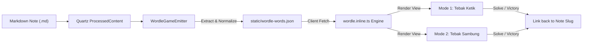

# Quartz Wordle & Connect Game Plugin (`v01-01_wordle-dual-mode-quartz-plugin`)

> **Version**: `v01-01` (Dual-Mode Emitter & Interactive Component Milestone)  
> **Baseline References**:  
> - [`all-lads-tool/skill/briefing-0x-0x-version.md`](file:///d:/0pro/pakcli-plugin/all-lads-tool/skill/briefing-0x-0x-version.md)  
> - [`all-lads-tool/skill/uiux-wireframe-via-text-ascii-codeblock.md`](file:///d:/0pro/pakcli-plugin/all-lads-tool/skill/uiux-wireframe-via-text-ascii-codeblock.md)  
> - [`human-atlas/brief/v18_halo-wordl-wannabe.md`](file:///d:/0pro/pakcli-plugin/human-atlas/brief/v18_halo-wordl-wannabe.md)  
> - [`quartz-plugin-tts/ARCHITECTURE.md`](file:///d:/0pro/pakcli-plugin/quartz-plugin-tts/ARCHITECTURE.md)  
>
> **Primary Objectives**:
> 1. Unified dual-engine Quartz plugin integrating Mode 1 (Tebak Ketik Wordle) and Mode 2 (Tebak Sambung Wheel Connect).
> 2. Zero-config content-scoped extraction from Quartz Markdown notes (Title/Word, Clue, Explanation, Folder).
> 3. Dynamic category/folder and word-length selection ("Selected Stuff").
> 4. Active recall reinforcement linking solved words directly back to source vault notes.
> 5. Responsive fake 3D chiclet UI/UX with zero horizontal scroll on mobile viewports (`<= 60 cols`).

---

## 📑 DAFTAR ISI (TABLE OF CONTENTS)

- [1. Section 0: Title & Metadata Block](#quartz-wordle--connect-game-plugin-v01-01_wordle-dual-mode-quartz-plugin)
- [2. Section 1: Daftar Isi (Table of Contents)](#-daftar-isi-table-of-contents)
- [3. Section 2: Architectural Directives & Invariants](#3-section-2-architectural-directives--invariants)
- [4. Section 3: Directory Topology & Boundaries](#4-section-3-directory-topology--boundaries)
- [5. Section 4: Data Models & YAML Frontmatter Engine](#5-section-4-data-models--yaml-frontmatter-engine)
- [6. Section 5: UI/UX Monospace Text Wireframes](#6-section-5-uiux-monospace-text-wireframes)
  - [5.1 Atomic Component Wireframes](#51-atomic-component-wireframes)
  - [5.2 Desktop Wireframe (<= 76 cols)](#52-desktop-wireframe--76-cols)
  - [5.3 Mobile Portrait Wireframe (<= 60 cols)](#53-mobile-portrait-wireframe--60-cols)
  - [5.4 Mode 2: Connect Wheel Wireframe](#54-mode-2-connect-wheel-wireframe)
  - [5.5 Victory Recap & Vault Note Link Modal](#55-victory-recap--vault-note-link-modal)
- [7. Section 6: Subsystem Deep-Dives](#7-section-6-subsystem-deep-dives)
  - [6.1 Two-Pass Wordle Evaluation & SDM Closeness Math](#61-two-pass-wordle-evaluation--sdm-closeness-math)
  - [6.2 Connect Wheel Trigonometric Platter Topology](#62-connect-wheel-trigonometric-platter-topology)
  - [6.3 Pointer Hitbox Collision & SVG Line Routing](#63-pointer-hitbox-collision--svg-line-routing)
  - [6.4 Tactile Chiclet Fake 3D SCSS Elevation](#64-tactile-chiclet-fake-3d-scss-elevation)
- [8. Section 7: Unified Build Pipeline & Verification](#8-section-7-unified-build-pipeline--verification)

---

## 3. Section 2: Architectural Directives & Invariants

1. **RULE #1: Zero External Runtime Dependency**:
   - The browser gameplay runtime must be 100% self-contained in `wordle.inline.ts` and compiled via `tsup` into an inline script string.
   - Zero third-party web fonts, external CDNs, or heavy UI libraries required at runtime.
2. **RULE #2: Mobile Viewport Constraints (`320px – 768px`)**:
   - Strictly **zero horizontal overflow** (`overflow-x: clip; box-sizing: border-box`).
   - Wireframe budget strictly enforces `<= 60 characters` for all mobile diagrams.
3. **RULE #3: Decoupled Domain Isolation**:
   - The plugin core contains **zero hardcoded subject matter** (no hardcoded chemistry elements, biology organs, or sport rules).
   - All vocabulary, categories, hints, and explanations are discovered dynamically from the hosting vault.
4. **RULE #4: Dual Engine Integration (One Plugin)**:
   - Both Mode 1 (Typing Wordle) and Mode 2 (Connect Wheel) coexist inside the same component bundle.
   - Mode switching preserves active word state without reloading page assets.
5. **Strict ZERO `id:` Standard**:
   - Unique word identifiers are derived strictly from normalized slugs and cleaned target tokens (`word_${slug}_${token}`), never arbitrary incrementing database IDs.

---

## 4. Section 3: Directory Topology & Boundaries

```text
quartz-plugin-game-wordle/
├── src/                                  # Platform Plugin Source
│   ├── build/                            # Build Validation Utilities
│   │   └── validate-manifest.ts          # Checks package.json quartz descriptor
│   ├── components/                       # Quartz UI Components
│   │   ├── scripts/                      # Client-Side Inline TypeScript
│   │   │   └── wordle.inline.ts          # Dual-Mode Game Client Engine
│   │   ├── styles/                       # Component Styling
│   │   │   └── wordle.scss               # Chiclet 3D, Flip & Wheel Styles
│   │   ├── index.ts                      # Component Exports
│   │   └── WordleGame.tsx                # Preact Component Constructor
│   ├── util/                             # General Helpers
│   │   └── lang.ts                       # ClassName concatenator
│   ├── emitter.ts                        # Quartz Emitter (Word Bank Generator)
│   ├── filter.ts                         # Optional Page Filter
│   ├── transformer.ts                    # Optional AST Transformer
│   ├── types.ts                          # TypeScript Contract Definitions
│   └── index.ts                          # Plugin Package Entry Point
├── test/                                 # Unit & Integration Tests
│   ├── emitter.test.ts                   # Emitter extraction tests
│   └── helpers.ts                        # Mock VFile and BuildCtx fixtures
├── dist/                                 # Compiled Production Distribution
├── package.json                          # Manifest with "quartz" metadata
├── README.md                             # User Documentation
└── tsup.config.ts                        # Bundler with inline-script-loader
```

---

## 5. Section 4: Data Models & YAML Frontmatter Engine

### 4.1 Word Item Schema

```ts
export interface WordItem {
  id: string;              // Deterministic slug: word_unsur_oksigen
  word: string;            // Uppercase ASCII token: "OKSIGEN"
  clue: string;            // Primary clue for puzzle prompt
  explanation: string;     // Post-solve educational excerpt
  slug: string;            // Quartz internal route: "/Unsur/Oksigen"
  folder: string;          // Source folder: "Unsur"
  tags: string[];          // Tags: ["kimia", "gas"]
  level: "short" | "medium" | "long";
}
```

### 4.2 Frontmatter Extraction Contract

```markdown
---
title: Oksigen
clue: Unsur gas vital bagi pernapasan makhluk hidup.
explanation: Oksigen adalah gas tak berwarna pembentuk 21% atmosfer bumi.
tags: [kimia, unsur]
---
Oksigen adalah unsur kimia dengan nomor atom 8...
```

| Field | Source Priority | Fallback Strategy |
| :--- | :--- | :--- |
| `word` | `frontmatter.word` $\rightarrow$ `frontmatter.title` $\rightarrow$ `vfile.stem` | Cleaned to uppercase ASCII `[A-Z]` |
| `clue` | `frontmatter.clue` $\rightarrow$ `frontmatter.description` | First paragraph sentence (max 140 chars) |
| `explanation` | `frontmatter.explanation` $\rightarrow$ `frontmatter.description` | Defaults to `clue` |
| `folder` | First segment of `vfile.data.slug` | Defaults to `"Umum"` |



---

## 6. Section 5: UI/UX Monospace Text Wireframes

### 5.1 Atomic Component Wireframes

#### Component A: Folder & Length Filter Row (54 cols)
```text
┌────────────────────────────────────────────────────┐
│ Topik:   [ 📁 Semua Topik (42)       v ]           │
│ Panjang: [ Semua                     v ]           │
└────────────────────────────────────────────────────┘
```

#### Component B: Mode Switcher Segmented Control (54 cols)
```text
┌────────────────────────────────────────────────────┐
│ [ ⌨️ Mode Ketik (Wordle) ] │ [ 🎡 Mode Sambung ]   │
└────────────────────────────────────────────────────┘
```

#### Component C: Clue Card (54 cols)
```text
┌────────────────────────────────────────────────────┐
│ PETUNJUK (7 HURUF)                     [ FOLDER ]  │
├────────────────────────────────────────────────────┤
│ Unsur gas yang kita hirup untuk bernapas setiap    │
│ detik.                                             │
└────────────────────────────────────────────────────┘
```

#### Component D: Closeness SDM Meter (54 cols)
```text
┌────────────────────────────────────────────────────┐
│ METER KEDEKATAN           SDM Tinggi (Hampir Dekat)│
│ [██████████████████████░░░░░░░░░░░░░░░░░░░] 60%    │
└────────────────────────────────────────────────────┘
```

---

### 5.2 Desktop Wireframe (<= 76 cols)

```text
┌────────────────────────────────────────────────────────────────────────┐
│ 🎮 TEBAK KATA VAULT                                    [ Folder: Kimia ]│
├────────────────────────────────────────────────────────────────────────┤
│ Topik:   [ 📁 Unsur (18 Kata)         v ]   Panjang: [ 5-6 Huruf   v ] │
│                                                                        │
│ [ ⌨️ Mode Ketik (Wordle) * ]  │  [ 🎡 Mode Sambung (Wheel) ]            │
├────────────────────────────────────────────────────────────────────────┤
│ CLUE (7 HURUF)                                                         │
│ Unsur gas vital bagi pernapasan semua makhluk hidup di muka bumi.      │
├────────────────────────────────────────────────────────────────────────┤
│ METER KEDEKATAN                                 SDM Tinggi (60%)       │
│ [████████████████████████████░░░░░░░░░░░░░░░░░░░░]                     │
├────────────────────────────────────────────────────────────────────────┤
│                                                                        │
│                      ┌───┬───┬───┬───┬───┬───┬───┐                     │
│               Try 1: │ K │ A │ R │ B │ O │ N │ * │ (Wrong)             │
│                      ├───┼───┼───┼───┼───┼───┼───┤                     │
│               Try 2: │ O │ K │ S │ I │ D │ A │ * │ (Close)             │
│                      ├───┼───┼───┼───┼───┼───┼───┤                     │
│               Try 3: │ O │ K │ S │ I │ G │ E │ N │ (SOLVED!)           │
│                      ├───┼───┼───┼───┼───┼───┼───┤                     │
│               Try 4: │   │   │   │   │   │   │   │                     │
│                      └───┴───┴───┴───┴───┴───┴───┘                     │
│                                                                        │
│               [ 💡 Buka 1 Huruf ]         [ Lewati Kata ➔ ]             │
├────────────────────────────────────────────────────────────────────────┤
│ VIRTUAL CHICLET KEYBOARD                                               │
│ [ Q ][ W ][ E ][ R ][ T ][ Y ][ U ][ I ][ O ][ P ]                     │
│   [ A ][ S ][ D ][ F ][ G ][ H ][ J ][ K ][ L ]                        │
│ [ ENTER ][ Z ][ X ][ C ][ V ][ B ][ N ][ M ][ ⌫ ]                      │
└────────────────────────────────────────────────────────────────────────┘
```

---

### 5.3 Mobile Portrait Wireframe (<= 60 cols)

```text
┌────────────────────────────────────────────────────────┐
│ 🎮 TEBAK KATA                               [ Kimia ]  │
├────────────────────────────────────────────────────────┤
│ [ 📁 Unsur               v ]  [ Panjang: 5-6         v ]│
│                                                        │
│ [ ⌨️ Ketik * ]             [ 🎡 Sambung ]              │
├────────────────────────────────────────────────────────┤
│ CLUE (7 HURUF)                                         │
│ Unsur gas vital bagi pernapasan makhluk hidup.         │
├────────────────────────────────────────────────────────┤
│ SDM: SDM Tinggi (60%)                                  │
│ [██████████████████░░░░░░░░░░░░░░]                     │
├────────────────────────────────────────────────────────┤
│                                                        │
│              ┌───┬───┬───┬───┬───┬───┬───┐             │
│       Row 1: │ K │ A │ R │ B │ O │ N │ * │             │
│              ├───┼───┼───┼───┼───┼───┼───┤             │
│       Row 2: │ O │ K │ S │ I │ G │ E │ N │             │
│              ├───┼───┼───┼───┼───┼───┼───┤             │
│       Row 3: │   │   │   │   │   │   │   │             │
│              └───┴───┴───┴───┴───┴───┴───┘             │
│                                                        │
│         [ 💡 Buka Huruf ]      [ Lewati ➔ ]            │
├────────────────────────────────────────────────────────┤
│ [ Q ][ W ][ E ][ R ][ T ][ Y ][ U ][ I ][ O ][ P ]     │
│   [ A ][ S ][ D ][ F ][ G ][ H ][ J ][ K ][ L ]        │
│ [ ENTER ][ Z ][ X ][ C ][ V ][ B ][ N ][ M ][ ⌫ ]      │
└────────────────────────────────────────────────────────┘
```

---

### 5.4 Mode 2: Connect Wheel Wireframe

```text
┌────────────────────────────────────────────────────────┐
│ 🎮 TEBAK KATA                               [ Kimia ]  │
├────────────────────────────────────────────────────────┤
│ [ ⌨️ Ketik ]               [ 🎡 Sambung * ]             │
├────────────────────────────────────────────────────────┤
│ KATA TARGET (7 HURUF):                                 │
│                                                        │
│          [ O ]  [ K ]  [ S ]  [ I ]  [ _ ]  [ _ ]  [ _ ]│
├────────────────────────────────────────────────────────┤
│                                                        │
│                    ( N )       ( O )                   │
│                                                        │
│              ( E )        [G]        ( K )             │
│                                                        │
│                    ( I )       ( S )                   │
│                                                        │
│          (Drag atau ketuk huruf untuk menyambung)      │
├────────────────────────────────────────────────────────┤
│        [ 🔀 Acak ]     [ ↩️ Hapus ]     [ Lewati ➔ ]    │
└────────────────────────────────────────────────────────┘
```

---

### 5.5 Victory Recap & Vault Note Link Modal

```text
┌────────────────────────────────────────────────────┐
│               🎉 BERHASIL DITEBAK!                 │
├────────────────────────────────────────────────────┤
│                    OKSIGEN                         │
├────────────────────────────────────────────────────┤
│ Petunjuk:                                          │
│ Gas esensial bagi respirasi aerobik makhluk hidup. │
│                                                    │
│ Rangkuman Vault:                                   │
│ Oksigen adalah unsur kimia dengan lambang O dan    │
│ nomor atom 8, menyusun 21% atmosfer bumi.          │
├────────────────────────────────────────────────────┤
│ [ 📖 Baca Catatan Lengkap di Vault ↗ ]              │
│                                                    │
│ [ ➔ Tebak Kata Berikutnya ]                        │
└────────────────────────────────────────────────────┘
```

---

## 7. Section 6: Subsystem Deep-Dives

### 6.1 Two-Pass Wordle Evaluation & SDM Closeness Math

```ts
function evaluateWordle(guess: string, target: string) {
  const statuses = Array(guess.length).fill("wrong");
  const targetChars = target.split("");
  const guessChars = guess.split("");

  // Pass 1: Identical match (Green)
  for (let i = 0; i < guessChars.length; i++) {
    if (guessChars[i] === targetChars[i]) {
      statuses[i] = "right";
      targetChars[i] = "#";
    }
  }

  // Pass 2: Present elsewhere (Yellow)
  for (let i = 0; i < guessChars.length; i++) {
    if (statuses[i] !== "right") {
      const idx = targetChars.indexOf(guessChars[i]);
      if (idx !== -1) {
        statuses[i] = "wrong-pos";
        targetChars[idx] = "#";
      }
    }
  }
  return statuses;
}
```

$$\text{Closeness} = \frac{(\text{right} \times 2) + (\text{wrong\_pos} \times 1)}{\text{target.length} \times 2} \times 100\%$$

* **0% – 39%**: `SDM Revisi (Masih Jauh)`
* **40% – 99%**: `SDM Tinggi (Hampir Dekat)`
* **100%**: `SDM Mengerikan (Tepat Sempurna!)`

---

### 6.2 Connect Wheel Trigonometric Platter Topology

Nodes are arranged uniformly across a circular platter of radius $R = 86\text{px}$ centered at $(130, 130)$:

$$\theta_i = \left(i \times \frac{360^\circ}{N} - 90^\circ\right) \times \frac{\pi}{180^\circ}$$
$$x_i = C_x + R \times \cos(\theta_i), \quad y_i = C_y + R \times \sin(\theta_i)$$

For 7-letter words, a 6-perimeter polygon is formed with the 7th node pinned at the geometric center $(C_x, C_y)$.

---

### 6.3 Pointer Hitbox Collision & SVG Line Routing

* **Collision Radius**: Distance between pointer $(P_x, P_y)$ and node $(N_x, N_y)$ is checked via Euclidean norm:
  $$d = \sqrt{(P_x - N_x)^2 + (P_y - N_y)^2} < 30\text{px}$$
* **Dynamic Line**: An `<svg>` overlay renders connected `<line>` segments between all `selectedIndices` plus an active trailing line to current pointer coordinates.

---

### 6.4 Tactile Chiclet Fake 3D SCSS Elevation

```scss
.qgw-chiclet-btn {
  border: 1px solid var(--qgw-border);
  border-bottom: 3.5px solid var(--qgw-border);
  background: var(--qgw-bg);
  border-radius: 6px;
  cursor: pointer;
  transition: transform 0.08s ease, border-bottom-width 0.08s ease;

  &:active {
    transform: translateY(2.5px);
    border-bottom-width: 1px;
  }
}
```

---

## 8. Section 7: Unified Build Pipeline & Verification

### 8.1 Build Command
```bash
npm run build
```
*(Executes `tsup`, compiling `.inline.ts` via esbuild and `.scss` via sass into standalone ESM modules).*

### 8.2 Test Suite Execution
```bash
npm run test
```
*(Runs vitest suite validating `WordleGameEmitter` manifest production and frontmatter extraction).*

### 8.3 Output Bundle Audit
| Output Artifact | Format | Description |
| :--- | :--- | :--- |
| `dist/index.js` | ESM | Exports `WordleGameEmitter` and `WordleGame` |
| `dist/components/index.js` | ESM | Standalone component exports |
| `dist/index.d.ts` | DTS | Full TypeScript type definitions |
